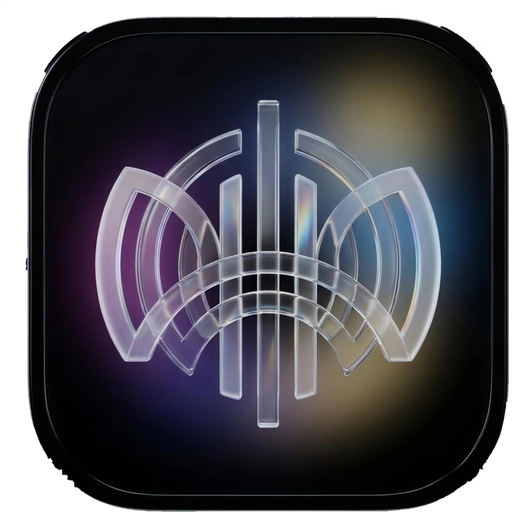

<p align="center">
  
</p>

<h1 align="center">Lumen</h1>

<p align="center">
  A local music player for Android with a <b>liquid-glass</b> interface, silky spring animations,<br>
  and support for the formats other players skip, including <b>Apple Lossless (ALAC) .m4a</b>.
</p>

<p align="center">
  Made by <a href="https://github.com/yexclsv"><b>yexclsv</b></a>
</p>

---

## What's new in 2.1

- **Discord Rich Presence**: your Discord profile shows what you're listening to, with a live progress bar. Updates reach Discord within about a second of a song change, pause or seek (see [Discord setup](#discord-rich-presence-setup))
- Fixed settings content showing above the top bar and over the status bar while scrolling
- Fixed lyrics lines appearing twice when a `.lrc` line carries start/end time tags
- Lyrics now fade softly at the top and bottom

## What's new in 2.0

- **Animated intro screen** with the logo and a loading pulse, plus a matching Android 12+ splash
- **Browse by album and artist**, with playlists, in the new **Browse** tab
- **Lyrics**: add a `.lrc` file or paste text. Time-stamped lyrics highlight and scroll in sync, and you can tap a line to jump to it
- **Player gestures**: swipe the album art to change songs, double-tap it to like
- **Queue tools**: save the queue as a playlist, or clear what's coming up
- **Hide songs** you never want to see, and restore them from Settings
- **Song info**: format, bitrate, sample rate, size
- **Launcher shortcuts**: long-press the icon for *Shuffle all* and *Search*

## Features

**Playback**
- Plays your own files: MP3, AAC, FLAC, OGG, WAV, Opus and more, plus **ALAC (Apple Lossless) `.m4a`** through a built-in software decoder
- Background playback with a notification and lock-screen controls
- Spotify-style notification: favorite (heart) and shuffle buttons next to previous / play / next, a progress bar, and live artwork
- Queue ("Up next"), shuffle, repeat, playback speed (0.5x to 2x), sleep timer, now with **end of this song**
- **Resume where you left off**: the queue and position are restored when you reopen the app *(new in 1.1)*
- Open any audio file from your file manager with **Open with → Lumen**
- Unplayable files are skipped automatically, and the real error is shown so you know why

**Sound** *(new in 1.1)*
- **Equalizer** with the device's built-in presets and a slider for every band
- **Bass boost** and **loudness boost**
- **Skip silence** to trim quiet gaps

**Library**
- Finds music through Android's media library, and lets you add **individual files or whole folders** from anywhere on the device
- Browse by **album** and **artist**; search, filter (All / Favorites / Added / **Top / History**), and sort (title, artist, album, date added, duration)
- **Most played** and **play history**, built from what you actually listen to *(new in 1.1)*
- **More from this artist / album** and **Share** in every song's menu *(new in 1.1)*
- Playlists and Favorites
- **Rename songs and change covers** (title, artist, album, cover image). Edits are saved inside the app and never touch your audio files, so they work on read-only storage too

**Updates and data** *(new in 1.1)*
- **Built-in updater**: checks [GitHub Releases](https://github.com/Yexclsv25/Lumen-Music/releases) (automatically every 12 hours, or on demand), shows the release notes, downloads the APK with a progress bar and hands it to Android's installer. You can skip a version
- **Backup and restore** your favorites, playlists, song edits, listening stats and settings to a single file
- **Listening stats** in Settings
- A "What's new" note after each update

**Look and feel**
- **Liquid glass** bars, tab bar, mini player and menus: live GPU blur of what's behind them (Android 12+), plus a lens-refraction shader at the edges (Android 13+)
- Ambient glow and accent colors that follow the current album art
- Spring-based animations everywhere: sliding tab indicator, drag-to-dismiss player, bouncy buttons, a scrubber that swells under your finger
- Themes: Midnight, AMOLED, Graphite, Navy backgrounds; 5 accent colors plus a custom hue; adjustable glass blur and tint
- Haptic feedback (can be turned off)

## Requirements

| | |
|---|---|
| Android | 8.1 (API 27) or newer |
| Glass blur | Android 12+ (older versions get a tinted fallback) |
| Lens refraction | Android 13+ |

## Permissions

| Permission | Why |
|---|---|
| `READ_MEDIA_AUDIO` / `READ_EXTERNAL_STORAGE` | Find music on the device |
| `POST_NOTIFICATIONS` | Playback notification (Android 13+) |
| `FOREGROUND_SERVICE_MEDIA_PLAYBACK` | Keep playing in the background |
| `INTERNET` | Only to ask GitHub for the latest release and download updates |
| `REQUEST_INSTALL_PACKAGES` | Lets Lumen hand a downloaded update to the installer |

If you enable Discord Rich Presence, the song title, artist and playback time are sent to Discord to show on your profile. It is off by default.

Lumen sends no analytics and uploads nothing. The only network request is the update check, which you can turn off in **Settings → Updates**.

## Build

Open the project in **Android Studio** or **AndroidIDE** and run the `app` module, or from a terminal:

```bash
./gradlew assembleDebug
```

The APK is written to `app/build/outputs/apk/debug/`. The first sync needs internet to download dependencies.

## Project layout

```
app/src/main/
├── java/.../alac/        Apple Lossless decoder (Media3 renderer + pure-Java core)
├── kotlin/.../
│   ├── MainActivity.kt   screens, menus, player sheet
│   ├── PlayerViewModel   library flows, queue, rename/cover edits
│   ├── PlaybackService   Media3 session, notification buttons
│   ├── audio/            equalizer, bass boost, loudness (AudioFx)
│   ├── update/           GitHub release checker, downloader, installer hand-off
│   ├── data/             scanner, art loader, storage, backup
│   └── ui/               GlassLayout, tab bar, seek bar, settings, adapters
└── res/                  layouts, icons, themes
```

## How the glass works

`GlassLayout` redraws the view behind it (the *backdrop*) into a `RenderNode`, blurs it on the GPU with `RenderEffect`, clips it to a rounded shape, then adds a tint, a top sheen and a specular rim. On Android 13+ an AGSL shader also bends and slightly splits the light near the edges. Glass surfaces are refreshed only when something behind them changes, so there is no constant render loop.

## ALAC support

Android has no built-in Apple Lossless decoder, so Lumen ships its own in `alac/AlacDecoderCore.java`, wired into ExoPlayer as an extra audio renderer. It handles mono and stereo, 16/20/24/32-bit, and was checked sample-for-sample against FFmpeg's output on real files.

## Discord Rich Presence setup

Rich Presence uses the official **Discord Social SDK**, which can't be bundled with Lumen, so you add it yourself once:

1. Create an application in the [Discord Developer Portal](https://discord.com/developers/applications) and copy its **Application ID**
2. Enable the **Social SDK** for the application and add the redirect URI `discord-<YOUR_APPLICATION_ID>:/authorize/callback` (follow Discord's *Getting started with the Social SDK on Android* guide)
3. In *Rich Presence → Art Assets*, upload your logo with the key **`lumen`**
4. Download the **Android SDK** from the Social SDK page and put its `.aar` file in `app/libs/`
5. Open `gradle.properties` and set `discordAppId=<YOUR_APPLICATION_ID>`
6. Rebuild. In the app go to **Settings → Discord**, switch on *Show what I'm playing*, then tap *Connect Discord account* and approve in the browser

Without the `.aar` the project builds normally and the Discord section just says the SDK isn't installed. If the SDK version you downloaded names something differently, only `app/src/discord/kotlin/.../DiscordPresence.kt` needs adjusting.

## Releasing an update

The in-app updater reads the **latest GitHub release** of this repository.

1. Raise `versionCode` and `versionName` in `app/build.gradle` (for example `5` / `'2.1'`)
2. Build a **release** APK and sign it with **the same keystore every time**. Android refuses to update an app when the signing key changes
3. On GitHub: *Releases → Draft a new release*, tag it `v2.1` (the tag must match the version, with or without the `v`), and write the release notes
4. Attach the `.apk` file as a release asset

Installed copies that are older than the tag will then offer the update. The release notes you write are what users see in the update dialog.

## Known limitations

- Renaming and cover changes are stored in the app, not written into the audio files' tags
- ALAC with more than two channels isn't supported
- The equalizer needs a song to have played once so Android can create it
- Updates only install over a copy signed with the same key

## Roadmap

- [x] Equalizer (1.1)
- [x] In-app updates (1.1)
- [x] Lyrics from `.lrc` or pasted text (2.0)
- [ ] Lyrics embedded in audio tags
- [x] Album and artist views (2.0)
- [ ] Crossfade
- [ ] Home-screen widget
- [ ] Android Auto

## Credits

- Created by **yexclsv**
- Source: <https://github.com/Yexclsv25/Lumen-Music>
- Playback by [AndroidX Media3](https://developer.android.com/media/media3) (Apache 2.0)
- UI components from [Material Components for Android](https://github.com/material-components/material-components-android) (Apache 2.0)
- Spring animations from AndroidX DynamicAnimation, colors from AndroidX Palette

## License

Released under the [MIT License](LICENSE). © 2026 yexclsv.
